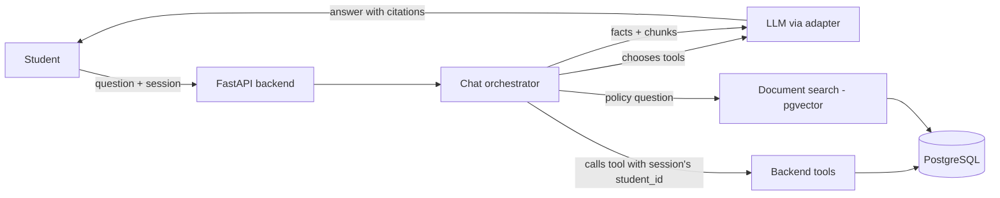

# CampusGPT — Project Plan

Living document. Update it when a decision changes.

- **Start:** 2026-10-13
- **Final deadline:** ~2026-11-13 (one month of daily work)
- **Team:** multiple members; one main development machine

## Progress log

### ▶ START HERE NEXT SESSION (written 2026-10-25)
1. `make db-start` (the database does not start after a reboot), `make llm` in a second
   terminal for the local model, then `make test` -- expect 162 passing.
2. **Admin upload + ingestion worker** (activity: IPC, an evaluated component). Store the
   uploaded file bytes in the database (planned: new `document_files` table or a `bytea`
   column, Alembic migration 0002), so the upload, its file and its job commit together.
   - `POST /api/admin/documents` (admin only): validate type/size, `documents.register()`,
     insert an `ingestion_jobs` row, `pg_notify('ingest_jobs', ...)`, reply 202.
   - `campusgpt/worker.py` (`make worker`): separate process, `LISTEN ingest_jobs` with a
     30 s polling fallback, claim with `FOR UPDATE SKIP LOCKED`, call `documents.index()`,
     set the job to done/failed in the same transaction; retry stale jobs (10 min, 3 tries).
   - `GET /api/admin/documents[/{id}]` for status; admin page in the frontend with upload
     form and live progress (poll every 2 s).
   - Tests: enqueue/claim, two workers never take the same job, failure leaves nothing
     searchable, superseded version disappears from search.
3. Then: end-term eligibility check, security demo + audit viewer, .ics export, benchmark
   (Hinglish questions, retrieval-mode comparison hybrid vs semantic vs lexical).
4. Small debts: design doc libraries table says sentence-transformers (now fastembed);
   login rate limiting (NFR-S5) still missing.

### 2026-10-25 — policy documents and RAG done
Six **synthetic** policy documents in `docs/policies/` (attendance, examinations, fees and
refunds, hostel, scholarships, academic integrity), consistent with the generated data (75%
rule, Rs 3,500 exam fee, no admit card with unpaid fees, 48-hour late window).
`campusgpt/documents.py`: extract (Markdown, text, PDF via pypdf with header/footer and
hyphenation cleaning), section-aware sliding-window chunking, BGE-small embeddings,
versioning (same title = new version, old one superseded in the same transaction).
`campusgpt/retrieval.py`: hybrid search, pgvector cosine + PostgreSQL full-text (OR-ed
terms), fused with RRF (k = 60); `mode=semantic|lexical` for the evaluation. Tool
`search_university_documents` returns passages with a `cite` such as "Attendance Policy §4".
`make policies` (also run by `make seed`). 162 tests.

Live with qwen3:4b: the model still **skipped the search** on rule questions and invented a
citation ("Examination Policy §7"), so two model-independent safeguards in `chat.py`:
1. **Prefetch:** every question is embedded; if the best passage has cosine >= 0.62
   (`RAG_PREFETCH_MIN_SIMILARITY`), the passages are put into the system prompt before the
   first model turn. As a fake tool turn instead, the model stopped calling record tools
   ("What is my attendance in DBMS?" went unanswered), so it is in the instructions.
2. **Citation check:** every `[Document §n]` in the answer is matched against the retrieved
   cites (a clause §3.1 of a retrieved §3 counts); the `done` event lists them and the chat
   panel warns about unverified ones.
Similarity alone separates rule questions from record questions poorly (rule 0.60–0.80,
record 0.46–0.71) -- evidence for the trained intent router.

**Next:** admin upload + ingestion worker (LISTEN/NOTIFY, `FOR UPDATE SKIP LOCKED`) with
live progress -- `documents.register()` / `index()` are ready for it; uploaded files need
storing (bytea column or disk) so the worker can read them. Then eligibility check,
security demo + audit viewer, .ics export, benchmark (include retrieval-mode comparison).

### 2026-10-25 — local model on the laptop GPU
Ollama 0.40.2 in `~/.local/ollama` (no sudo), `make llm`. Model `qwen3:4b-instruct-2507-q4_K_M`
(non-thinking; the thinking Qwen3 spends 400–600 tokens per reply). Runs on the RTX 3050 via
the open-source NVK/Vulkan driver, but speed is erratic (26 → 2.5 tokens/s); CPU-only is a
steady 8.5 tokens/s. Install the NVIDIA driver for CUDA. Context raised to 8k (Ollama's 4k
default silently truncates). First live results: correct tool choice for single questions
(English and Hinglish), injection refused, what-if maths correct; **but it skipped the tool
on a two-part question and invented an exam (date, room, course)** -- motivates the answer
verifier and the intent router.

### 2026-10-25 — chat with tool calling (activity H) done
`POST /api/chat` streams Server-Sent Events (FastAPI's built-in SSE): `status` while a tool
runs, `tool` with the exact records used, `token` for answer text, `done` / `error`.
`campusgpt/tools.py` (registry with `@tool`, Pydantic argument schemas, role check, audit
entry per call; no tool accepts a student identity), `campusgpt/llm.py` (OpenAI-compatible
adapter for Groq / Gemini, scripted provider for tests), `campusgpt/chat.py` (bounded
tool loop, conversation history, messages saved with their sources). Frontend: chat panel
beside the dashboard with suggested questions from the student's data, live steps,
"Data used" chips, "Ask" buttons on weekly items, and a "What if I skip?" slider.
122 tests. **Needs `LLM_API_KEY` in `.env`** to talk to a real model.

**Next:** policy documents + RAG (`search_university_documents`), ingestion worker with
LISTEN/NOTIFY and live progress for admin uploads, end-term eligibility check, security
demo + audit viewer, calendar export, Hinglish questions in the benchmark.

### 2026-10-25 — student dashboard (activity G) done
`GET /api/student/dashboard` (student role only) built on `campusgpt/student.py`, a read-only
repository whose functions the chat tools will reuse: attendance with classes needed / can
miss (`campusgpt/calc.py`, exact `Fraction` arithmetic, checked against brute force), upcoming
exams, assignments due, fees with balances, notices for the student's department, and the
**"this week" summary** ranked with a binary heap. Next.js 16 frontend in `frontend/`
(TypeScript, Tailwind, Recharts): login page and dashboard; `/api/*` is proxied to FastAPI so
the cookie is same-origin. Run `make api` and `make web`, open http://localhost:3000.
Node.js 24 is installed user-locally in `~/.local/node`. 109 tests pass.

**Next:** chat with tool calling (activity H): LLM provider adapter (Groq/Gemini free tier),
tool registry over `campusgpt/student.py`, SSE streaming, chat panel on the dashboard.

### 2026-10-25 — authentication (activity F) done
FastAPI app (`campusgpt/api/app.py`, run with `make api`, docs at `/docs`) with
`POST /api/auth/login`, `POST /api/auth/logout`, `GET /api/auth/me`. Argon2id check (timing
equalised for unknown emails), server-side sessions keyed by the SHA-256 of a CSPRNG token,
HTTP-only SameSite=Lax cookie, 12-hour expiry, `current_user` / `require_role` dependencies,
audit-log entries for login and logout. 13 new tests (33 total), including expired, forged and
replayed tokens, role checks and per-student identity.

**Next:** student APIs + dashboard (activity G): attendance, exams, fees and notices for the
logged-in student, all scoped by `CurrentUser.student_id`. Login rate limiting (slowapi,
NFR-S5) is still to do.

### 2026-10-13 — where we left off
**Done:** SRS v1.1, Technical Design Document, presentation (18 slides); PostgreSQL + pgvector
set up; full schema (23 tables, migration 0001); synthetic data generator (5,000 students,
~20 s); 12 validation checks; 20 passing tests.

**Start next session with:**
1. `make db-start` (the database does not start automatically after a reboot), then
   `make seed` and `make test` to confirm everything works.
2. **Authentication (activity F):** login/logout endpoints in FastAPI, Argon2id password
   check, server-side sessions stored as token hashes in `sessions`, HTTP-only cookie,
   role check, and tests that one student can never read another's data.
3. Then **student APIs + dashboard (activity G)**.

**Teammates (no blockers):** write the synthetic policy documents (attendance, examinations,
fees, hostel), clearly marked fictional — needed for RAG in Week 3.

## 1. Scope

### In scope (submission version)

| Feature | Notes |
|---|---|
| Synthetic university database | ~3,000–5,000 students, departments, programs, courses, enrollments, attendance, exams, assignments, fees, notices |
| Login and roles | Two roles only: **student** and **admin** |
| Student data isolation | Enforced in the backend from the session; tested explicitly |
| Student dashboard | One page summarising attendance, upcoming exams, due assignments, fees |
| AI chat with tool calling | Read-only tools over the student's own data |
| Policy RAG with citations | Clearly labelled synthetic policy documents |
| Deterministic calculations | e.g. classes needed to reach 75% attendance |
| "What do I need to take care of this week?" | Rule-based prioritisation, explained in words by the LLM |
| Admin document upload | Upload a policy/notice → chunked, embedded, answerable in chat |
| Evaluation | ~50-question benchmark, baseline comparison, security tests |

### Out of scope (future work)

Faculty and super-admin roles · hostel and scholarship modules · actions that modify data (e.g. hostel requests) · analytics dashboard · OCR for scanned PDFs · reranking · integration with real university systems.

## 2. How a question is answered

The student ID passed to every tool comes from the authenticated session. The LLM cannot supply or change it.

## 3. Initial tool set (all read-only)

| Tool | Returns |
|---|---|
| `get_my_profile` | Name, program, semester, section |
| `get_my_attendance` | Per-course attended / total / percentage |
| `calculate_attendance_requirement` | Classes needed to reach a target %, computed in code |
| `get_my_exams` | Upcoming exams with dates |
| `get_my_assignments` | Assignments with due dates and submission status |
| `get_my_fee_status` | Invoices, paid and pending amounts |
| `search_university_documents` | Relevant policy chunks with document/section references |
| `search_notices` | Recent notices |
| `get_my_weekly_summary` | Prioritised items for the next 7 days |

## 4. Timeline

| Week | Dates | Goal | Done when |
|---|---|---|---|
| 1 | Oct 13–19 | Repo setup, DB schema, synthetic data generator, login | `make seed` builds a consistent DB; a demo student can log in |
| 2 | Oct 20–26 | Student APIs, dashboard, chat with tool calling | "What is my attendance in DBMS?" is answered from DB rows |
| 3 | Oct 27–Nov 2 | Policy docs, RAG, citations, combined questions, weekly summary | "Can I sit my exam?" uses attendance + policy and cites the policy |
| 4 | Nov 3–9 | Admin upload, security tests, evaluation, demo prep | Benchmark results recorded; cross-student access tests pass |
| — | Nov 10–13 | Buffer, report, rehearsal | — |

If time runs short, cut from the end: simplify admin upload first. Keep the evaluation.

## 5. Evaluation (for the report)

Compare four configurations on the same question set:

1. Plain LLM, no university context
2. RAG only (documents, no student data)
3. Database tools only (no documents)
4. Full CampusGPT

Measure: answer correctness, citation correctness, tool-selection accuracy, latency, and cross-student leakage / prompt-injection attempts blocked. Optionally run the full system with a local 8B model and a hosted larger model, and compare.

## 6. Team split (suggested)

- **Main machine (with Claude Code):** backend, database, AI orchestration, frontend.
- **Teammates:** writing the synthetic policy documents, building the benchmark questions with expected answers, report and presentation.

## 7. Decisions log

| Date | Decision | Reason |
|---|---|---|
| 2026-10-13 | Free hosted LLM API (Groq/Gemini) as primary; local model optional | Laptop has 7.5 GB RAM; stronger models for free; facts come from code so model strength matters less |
| 2026-10-13 | Student + admin roles only | One month deadline |
| 2026-10-13 | Read-only tools in v1 | Avoid write-action security complexity |
| 2026-10-13 | PostgreSQL + pgvector for both data and vectors | One database to run and back up |
| 2026-10-25 | fastembed (ONNX Runtime) instead of sentence-transformers for BGE-small | Same model and vectors without PyTorch (~1 GB less to install, faster CPU start); update the libraries table in the design doc |
| 2026-10-25 | Policy passages prefetched by similarity, citations checked in code | The 4B local model skips the search tool and invents citations; both checks are deterministic |
| 2026-10-25 | FastAPI's built-in `EventSourceResponse` instead of sse-starlette | Native since FastAPI 0.13x; one dependency fewer (update the libraries table in the design doc) |
| 2026-10-25 | One OpenAI-compatible adapter for all hosted models; default Groq `openai/gpt-oss-120b` | Groq and Gemini both expose the same API shape; switching is two `.env` lines |
| 2026-10-13 | Document ingestion runs in a separate worker process, woken by PostgreSQL LISTEN/NOTIFY over a durable `ingestion_jobs` table (claimed with `FOR UPDATE SKIP LOCKED`); chat answers stream over SSE | Keeps chat responsive; gives real, demonstrable IPC (evaluated component); no extra broker process on an 8 GB laptop |

## 8. Evaluation components (announced 2026-10-13)

| Component | Marks | Covered in |
|---|---|---|
| Technical Diagram | 5 | `docs/design` ch. 2–3; SRS Appendix B |
| Programming Concepts | 5 | `docs/design` ch. 4 |
| Inter-Process Communication | 5 | `docs/design` ch. 3 |
| Libraries | 5 | `docs/design` ch. 5 |
| SRS Document | 10 | `docs/srs` |

Slides: `python docs/slides/render_diagrams.py` then `python docs/slides/build_slides.py <sample-template.pptx>` (needs `python-pptx`; a local venv lives in `.venv-docs/`, git-ignored). The deck reuses the same diagram sources as the documents.

Documents are LaTeX; shared team details and styling live in `docs/common/preamble.tex`, diagrams in `docs/diagrams/`. Build with `tectonic -X compile <file>.tex` from the file's own directory.
