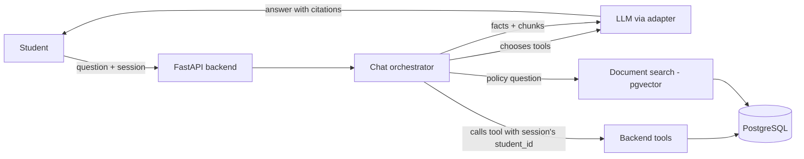

# CampusGPT — Project Plan

Living document. Update it when a decision changes.

- **Start:** 2026-10-13
- **Final deadline:** ~2026-11-13 (one month of daily work)
- **Team:** multiple members; one main development machine

## 1. Scope

### In scope (submission version)

| Feature | Notes |
|---|---|
| Synthetic university database | ~3,000–5,000 students, departments, programs, courses, enrollments, attendance, exams, assignments, fees, notices |
| Login and roles | Two roles only: **student** and **admin** |
| Student data isolation | Enforced in the backend from the session; tested explicitly |
| Student dashboard | One page summarising attendance, upcoming exams, due assignments, fees |
| AI chat with tool calling | Read-only tools over the student's own data |
| Policy RAG with citations | Clearly labelled synthetic policy documents |
| Deterministic calculations | e.g. classes needed to reach 75% attendance |
| "What do I need to take care of this week?" | Rule-based prioritisation, explained in words by the LLM |
| Admin document upload | Upload a policy/notice → chunked, embedded, answerable in chat |
| Evaluation | ~50-question benchmark, baseline comparison, security tests |

### Out of scope (future work)

Faculty and super-admin roles · hostel and scholarship modules · actions that modify data (e.g. hostel requests) · analytics dashboard · OCR for scanned PDFs · reranking · integration with real university systems.

## 2. How a question is answered

The student ID passed to every tool comes from the authenticated session. The LLM cannot supply or change it.

## 3. Initial tool set (all read-only)

| Tool | Returns |
|---|---|
| `get_my_profile` | Name, program, semester, section |
| `get_my_attendance` | Per-course attended / total / percentage |
| `calculate_attendance_requirement` | Classes needed to reach a target %, computed in code |
| `get_my_exams` | Upcoming exams with dates |
| `get_my_assignments` | Assignments with due dates and submission status |
| `get_my_fee_status` | Invoices, paid and pending amounts |
| `search_university_documents` | Relevant policy chunks with document/section references |
| `search_notices` | Recent notices |
| `get_my_weekly_summary` | Prioritised items for the next 7 days |

## 4. Timeline

| Week | Dates | Goal | Done when |
|---|---|---|---|
| 1 | Oct 13–19 | Repo setup, DB schema, synthetic data generator, login | `make seed` builds a consistent DB; a demo student can log in |
| 2 | Oct 20–26 | Student APIs, dashboard, chat with tool calling | "What is my attendance in DBMS?" is answered from DB rows |
| 3 | Oct 27–Nov 2 | Policy docs, RAG, citations, combined questions, weekly summary | "Can I sit my exam?" uses attendance + policy and cites the policy |
| 4 | Nov 3–9 | Admin upload, security tests, evaluation, demo prep | Benchmark results recorded; cross-student access tests pass |
| — | Nov 10–13 | Buffer, report, rehearsal | — |

If time runs short, cut from the end: simplify admin upload first. Keep the evaluation.

## 5. Evaluation (for the report)

Compare four configurations on the same question set:

1. Plain LLM, no university context
2. RAG only (documents, no student data)
3. Database tools only (no documents)
4. Full CampusGPT

Measure: answer correctness, citation correctness, tool-selection accuracy, latency, and cross-student leakage / prompt-injection attempts blocked. Optionally run the full system with a local 8B model and a hosted larger model, and compare.

## 6. Team split (suggested)

- **Main machine (with Claude Code):** backend, database, AI orchestration, frontend.
- **Teammates:** writing the synthetic policy documents, building the benchmark questions with expected answers, report and presentation.

## 7. Decisions log

| Date | Decision | Reason |
|---|---|---|
| 2026-10-13 | Free hosted LLM API (Groq/Gemini) as primary; local model optional | Laptop has 7.5 GB RAM; stronger models for free; facts come from code so model strength matters less |
| 2026-10-13 | Student + admin roles only | One month deadline |
| 2026-10-13 | Read-only tools in v1 | Avoid write-action security complexity |
| 2026-10-13 | PostgreSQL + pgvector for both data and vectors | One database to run and back up |
| 2026-10-13 | Document ingestion runs in a separate worker process, woken by PostgreSQL LISTEN/NOTIFY over a durable `ingestion_jobs` table (claimed with `FOR UPDATE SKIP LOCKED`); chat answers stream over SSE | Keeps chat responsive; gives real, demonstrable IPC (evaluated component); no extra broker process on an 8 GB laptop |

## 8. Evaluation components (announced 2026-10-13)

| Component | Marks | Covered in |
|---|---|---|
| Technical Diagram | 5 | `docs/design` ch. 2–3; SRS Appendix B |
| Programming Concepts | 5 | `docs/design` ch. 4 |
| Inter-Process Communication | 5 | `docs/design` ch. 3 |
| Libraries | 5 | `docs/design` ch. 5 |
| SRS Document | 10 | `docs/srs` |

Documents are LaTeX; shared team details and styling live in `docs/common/preamble.tex`, diagrams in `docs/diagrams/`. Build with `tectonic -X compile <file>.tex` from the file's own directory.
